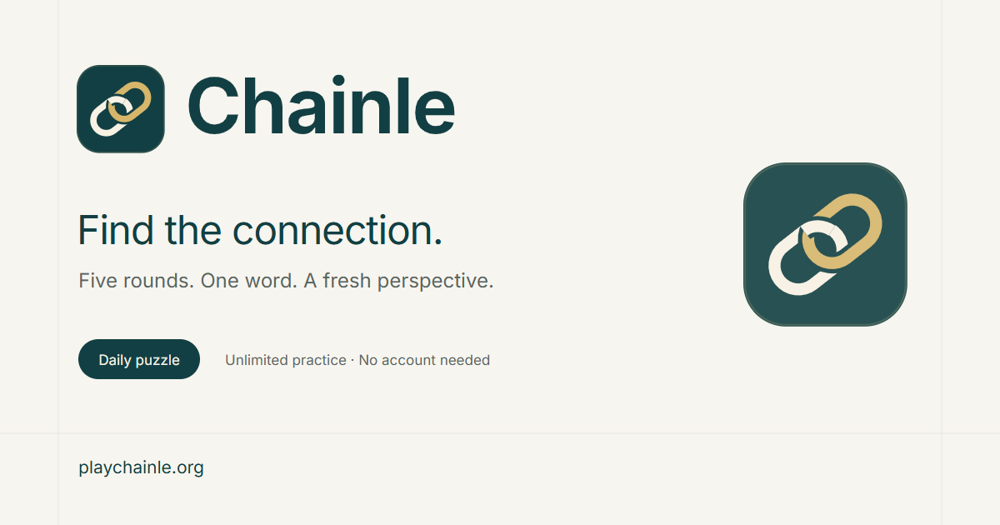
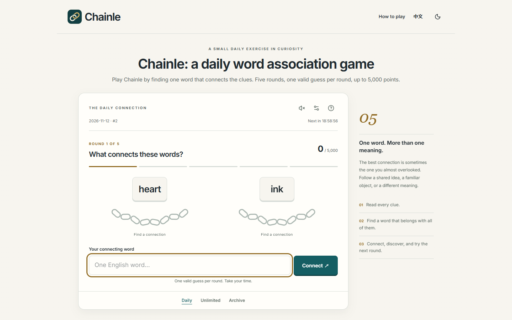

# Chainle: How to Play the Daily Word Connection Game

Chainle is a free daily word connection game where you choose one English word that connects the clues. Each session has five rounds, and each round gives you one valid guess. The challenge is to find a meaningful link across every clue, then see how strongly your choice connects.

Start the [Chainle game](https://playchainle.org/) in your browser when you are ready to try it. There is no account to create, no app to install, and no timer pushing you toward a rushed answer. This guide explains Chainle rules, useful thinking habits, and what the feedback actually tells you.

## What makes Chainle a word connection game?

The central question in Chainle is simple: what word belongs near all these ideas? You might connect clues through a shared category, an everyday use, or different meanings of the same word. Familiar vocabulary can be more useful than an obscure expression.

A word connection game rewards looking beyond your first association. If a clue makes you think of an object, consider its purpose, its materials, and the setting where someone uses it. Chainle asks you to bring those possibilities together in one answer.

The Chainle game uses semantic relationships: connections in meaning and usage. You do not need to rearrange letters or build a sequence by changing one letter at a time. Your task is to choose one candidate for the clues on screen.

## Chainle rules: the five rounds

Every Chainle session follows the same structure, so you can adjust your approach as the task changes.

| Round | Clues | Your task | Maximum score |
| --- | --- | --- | --- |
| 1 | Two words | Find one word connected to both | 1,000 |
| 2 | Two words | Find another balanced connection | 1,000 |
| 3 | Two words | Connect the next pair | 1,000 |
| 4 | Three words | Find a word linking all three | 1,000 |
| 5 | One word | Find a close connection in meaning | 1,000 |

The Chainle game allows one valid submission per round. An invalid entry does not consume that turn; a valid word does, even if its score disappoints you. Read the clues and check your spelling before selecting Connect or pressing Enter.

Chainle accepts playable English words from its vocabulary. For Chainle, enter a single word using letters, and avoid repeating a clue or submitting a prohibited close variant. In the final round, related forms of the clue can also be restricted. Follow the validation message if an entry is rejected.

## How to play your first Chainle game

1. Open the daily Chainle puzzle and read every clue before typing.
2. Think of several possible answers, keeping them in your head or on paper.
3. Ask how each candidate relates to each clue.
4. Submit the single word with the clearest shared connection.
5. Review the chains and points, then continue through all five rounds.

Give yourself time on your first Chainle game. There is no countdown, so a short pause is often more useful than an impulsive submission. If the site rejects a word, read the explanation and choose another valid entry.

After a successful submission, Chainle shows the connection to each clue. Use that moment to compare your intention with the feedback. This is where a word connection game becomes especially interesting: an answer can feel convincing to you while the scoring data represents it differently.

## A worked example: find the overlap

Imagine the clues TREE and DOG. These are teaching examples, not today's Chainle answers or a promise of any score.

For TREE, you might list leaf, branch, bark, and forest. For DOG, you might list pet, bark, leash, and puppy. The overlap is BARK: a tree's outer covering and a dog's vocal sound.

| Candidate | Connection to TREE | Connection to DOG | What to notice |
| --- | --- | --- | --- |
| LEAF | Direct botanical association | Weak everyday association | Concentrates on one clue |
| LEASH | Weak everyday association | Direct pet association | Has the opposite imbalance |
| BARK | Outer covering | A familiar sound | Offers a reason for both links |

The lesson for a Chainle game is to explain every connection before committing. A clever link to only one clue leaves part of the puzzle unresolved. An everyday word with two useful meanings gives you a stronger hypothesis to test.

Chainle scoring may still differ from this human explanation. A word connection game evaluates the relationships represented in its data; a satisfying pun or unusual interpretation is not automatically a top answer.

## How Chainle scoring works

Each Chainle round awards up to 1,000 points, making 5,000 the maximum total. Your Chainle submission is compared with each clue using fixed semantic data. Several different words can earn full points, so there is room for more than one successful idea.

In a two-clue Chainle round, balance matters. A very strong relationship with one clue cannot rescue a completely missing relationship with the other. In the three-clue round, seek a connection across all three; partial connections can earn points without reaching the maximum.

The Chainle game displays chains to make those relationships easier to inspect. Read the numeric score alongside the animation: a visual chain is a summary, not a precise substitute for the point total.

When you review a word connection game result, separate three questions: Was the entry accepted? Did it connect to every clue? How strong were those connections? A low Chainle score answers the scoring question; it does not establish that your interpretation of English is meaningless.

## Five strategies for stronger connections

### 1. Build a small list for each clue

Before submitting in Chainle, name three nearby ideas for each clue. Look for overlap between the lists. This makes a Chainle game easier to reason about than repeatedly staring at the same first guess.

### 2. Check ordinary meanings in Chainle

Ask what a clue means in a kitchen, workplace, conversation, or outdoor setting. Common objects and actions provide useful starting points in a word connection game. Chainle may recognize those relationships more clearly than a highly personal association.

### 3. Change the kind of relationship

If synonyms lead nowhere, try categories, functions, materials, and familiar contexts. A tool might connect through what it does; a place might connect through what happens there. Chainle rewards finding a candidate that reaches across the clues.

### 4. Challenge your weakest link

For every candidate, complete the sentence: “This connects to the remaining clue because…” If the explanation needs a long story, consider another word. In a Chainle game, noticing a weak connection before submission is more useful than defending it afterward.

### 5. Reset for the final round

The last Chainle round asks for closeness to one clue. Shift from bridging several ideas to finding a nearby meaning or closely related concept. The same word connection game now requires a different decision, so reread the round prompt.

## Daily puzzles, unlimited practice, and the archive

The daily Chainle game gives players on the site the same selection for that day. A new daily puzzle begins at 00:00 UTC. Your local calendar date can differ from the puzzle date, so check the displayed edition when comparing results.

Choose [Chainle unlimited practice](https://playchainle.org/unlimited) when you want another session. There is no session limit, but the collection is finite, so clues can repeat. Repeated material can help you compare different approaches without waiting for tomorrow.

The Chainle archive lets you revisit available earlier dates. Daily replay also offers a way to explore another answer while retaining your original first daily score. For useful Chainle practice, change one candidate at a time and ask which relationship improved.

A word connection game is easier to learn from when you review specific choices. Keep a small note of a surprising link, its possible meaning, and one alternative to consider later.

## Common questions about the Chainle game

### Is Chainle free?

Yes. The daily Chainle game and unlimited practice are free to play in your browser. You can begin without registering an account or downloading an application.

### Does Chainle save progress across devices?

Chainle progress stays in the same browser and device. Return there to continue your accepted guesses. Clearing site storage or switching browsers can remove access to that local progress; there is no account sync to rely on.

### Can I play Chainle in Chinese?

English and Simplified Chinese interfaces are available. Chainle clues and guesses remain English in either interface. Choose the instructions you prefer, while treating the puzzle itself as an English vocabulary activity.

### Why was my reasonable answer scored poorly?

The Chainle game uses fixed relationships in its semantic data. Uncommon meanings, cultural references, and personal associations may be represented imperfectly. Review the individual connections and try a clearer everyday relationship during practice.

### Is Chainle useful for vocabulary practice?

It offers a reason to explore meanings and associations. After a word connection game, look up an unfamiliar sense and write a sentence using it. [Princeton WordNet](https://wordnet.princeton.edu/) explains how word senses, synonyms, and semantic relationships can be organized. Treat your score as game feedback, rather than a language proficiency result.

## Share your reasoning and try another connection

When you finish Chainle, you can copy result text or generate a scorecard image. Check the Chainle scorecard before sharing: “Hide my answers” conceals your guesses, but clue words can still reveal part of the puzzle. Ask friends to finish their daily attempt before discussing specific answers.

For the next Chainle game, choose one habit to practice: making two short lists, checking the weakest link, or changing your approach for the final round. Then notice whether your explanations become clearer.

Ready to apply the ideas? Play [Chainle](https://playchainle.org/) and look for one word that earns its place beside every clue.

Questions or feedback: [support@playchainle.org](mailto:support@playchainle.org). Follow updates on [Pinterest](https://www.pinterest.com/veogen/) or connect on [LinkedIn](https://www.linkedin.com/in/drew-grant-200528328/).
